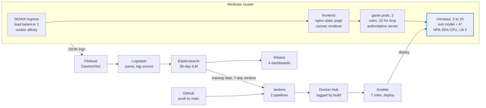

# SRS — Minotaur Maze (v2, reduced scope)

Nov 25, 2026 · @suryans

Minotaur Maze is a browser maze game whose monster uses a continuously retrained model to infer which exit the player is running for. This revision cuts roughly half the game and ML scope of v1 while keeping full coverage of all 30 CSE 816 marks, and fixes six design faults that would have failed on demo day.

## What changed from v1

Requirement IDs are never renumbered. A requirement that was removed keeps its ID, marked **Removed**, so the team's shared vocabulary and the traceability matrix stay stable.

| ID | v1 | v2 | Why |
|---|---|---|---|
| FR-G-01 | 5 fixed levels | 1 fixed level, randomised start position each game | No mark counts levels. A randomised start restores variety without a second maze file and stops classmates memorising routes, which would break balance mid-demo |
| FR-G-03 | 3–4 exits | Exactly 3 exits | Keeps the exit-prediction baseline at a constant 33%, so accuracy is comparable across every model version. Also makes the two-disjoint-routes constraint easy to satisfy |
| FR-G-10 | Smoke bomb | **Removed** | One more rule to test and balance, worth no marks |
| FR-G-16 | Leaderboard | **Removed** | Worth no marks and the only reason Redis needed persistence |
| FR-M-02 | Belief map from move-predictor rollout | Interception point on the route from last known position to the predicted exit | The hardest ML in v1 and worth nothing beyond the exit predictor. Interception is hand-written and uses the surviving model |
| 4.1 Models | Exit predictor + move predictor | Exit predictor only; move predictor is an optional stretch behind a config flag | One model carries the whole MLOps loop. It is also the better story: the model recovers the one piece of information the game hides from the Minotaur |
| FR-M-06 | 5,000 cold-start bot games | ~300 games, and only purposeful bots in the training set | 300 games is roughly 75,000 rows, ample for a 3-class classifier. 5,000 would exhaust Elasticsearch on a 16 GB host |
| FR-M-11 | Fun gate over 200 games | Fun gate over 50 games | Same signal, four times faster in the pipeline |
| FR-M-20 | Sweep selects nearest 50% catch rate over a 3×4 grid | Same objective, 2–3 combinations | `abs(catch_rate − 50)` stays the sweep objective. It is explicitly **not** the model promotion criterion — see Section 4.4 |
| FR-M-21 | Per-level speed fallback | **Removed** | Only one level |
| FR-D-12 | HPA on minotaur at 60% CPU | HPA on minotaur at 35% CPU | A lower target makes scaling visible under modest load on one laptop |
| FR-D-13 | HPA on game at 70% CPU | **Removed** | Game pods hold WebSockets and are I/O-bound; CPU never moves, so the HPA would sit at 2 replicas and look broken. One HPA satisfies CR-15 |
| FR-D-14 | Redis StatefulSet with a persistent volume | **Removed** | Nothing left needs it once the leaderboard and state checkpointing are gone. CR-05 is already covered by Deployment, Service, Ingress, HPA, Job and DaemonSet |
| FR-D-18 | 300 s termination grace period | 60 s | At `maxUnavailable: 0` two replicas drain serially, so 300 s makes the zero-downtime demo take over ten minutes |
| FR-D-19 | Redis state checkpointing and client reconnect | **Removed** | Already a stretch goal in v1. Drain-and-finish alone satisfies live patching |
| FR-M-16 | Drift alert posts to Slack or Telegram | Alert writes to an Elasticsearch index and a Kibana panel | On the free Elastic licence the only alerting connectors available are index and server log; Slack, webhook and email all require a paid subscription |
| 6.2 step 7 | Trivy fails the build on critical CVEs | Trivy reports, does not block | Base images acquire new criticals through no fault of ours, which would turn the pipeline red on demo day. gitleaks stays blocking because it is deterministic |
| NFR-01, NFR-03 | 200 concurrent games | 40 concurrent games | What is marked is that pods scale and latency recovers, not the number. 200 is not achievable alongside Minikube, Jenkins and ELK on 16 GB |
| FR-D-06 | Elasticsearch heap 2 GB | Elasticsearch heap 1 GB, Logstash 512 MB | See the RAM budget in Section 7 |

### Added in v2

| ID | Requirement | Why |
|---|---|---|
| FR-G-17 | The player's start cell is chosen at random from a set of valid start cells each game | Restores per-game variety with one level |
| FR-M-22 | If the minotaur service fails or exceeds its deadline, the game server falls back to rule-based hunting for that decision | Protects the demo, and is a genuine resilience talking point |
| FR-M-23 | Feature extraction lives in one shared module imported by both `model/` and `minotaur/` | Train/serve feature skew is the most likely way to silently lose accuracy |
| FR-D-23 | The app pipeline runs a 30-game fun check when `config/game.yaml` changes, and fails the build if the catch rate leaves the band | Lets the fun gate be demonstrated in two minutes without waiting for a training run |
| FR-D-24 | `config/game.yaml` is baked into the image at build time, never mounted as a ConfigMap | Ties settings to the build number, so every log event's `build` field identifies exactly which game dynamics produced it |

## 1. Introduction

### 1.1 Purpose

This document is the single reference for the team, the TA and the evaluators. It defines what the system must do, how it is built and operated, and where each CSE 816 requirement is satisfied (Section 9).

### 1.2 Scope

In scope:

- A single-player, grid-based maze game played in the browser: one fixed braid maze, fog of war for the Minotaur, three exits of which one is secretly active, and a randomised start cell.
- A Minotaur that hunts by sight and sound and uses one learned model to infer the player's target exit.
- An automated MLOps loop: telemetry → training → quality, fun and latency gates → versioned model image → rolling deployment → accuracy and drift monitoring → scheduled retraining.
- A complete DevOps toolchain: Git/GitHub, Jenkins, Docker, Docker Compose, Docker Hub, Ansible, Kubernetes, Ansible Vault and the ELK Stack.

Out of scope: user accounts and passwords, multiplayer, mobile clients, sound effects, a physics engine, a leaderboard, persistent game state, and production cloud hosting. The system runs on a local Kubernetes cluster (Minikube).

### 1.3 Definitions

| Term | Meaning |
|---|---|
| Active exit | The one exit of three, chosen at random each game, that lets the player win. Shown to the player, hidden from the Minotaur |
| Braid maze | A maze with some walls removed so loops exist and no single corridor is a bottleneck |
| Fog of war | The rule that the Minotaur knows the player's position only through line of sight or noise |
| Quality gate | A pipeline check that blocks a new model unless it predicts better than the production model and better than its baseline |
| Fun gate | A pipeline check that blocks a new model unless its catch rate against the sim bots stays between 40% and 60% |
| Sim bots | Scripted player bots with distinct habits, used for training data, gates and load tests |
| Purposeful bot | A sim bot that actually heads for an exit, and whose games are therefore valid training data |
| HPA | Kubernetes Horizontal Pod Autoscaler |
| ELK | Elasticsearch, Logstash and Kibana |

Requirement ID prefixes: **FR-G** gameplay, **FR-M** Minotaur and MLOps, **FR-D** DevOps, **NFR** non-functional, **CR** course requirement.

### 1.4 References

- CSE 816 Software Production Engineering, Final Project Guidelines and Evaluation Criteria (30 marks).
- IEEE 830-1998, Recommended Practice for Software Requirements Specifications (structure only).

## 2. Overall description

The product is a set of containerised services on Kubernetes, delivered by Jenkins and observed through ELK, with the game acting as both the user-facing application and the data source for the model.

### 2.1 Product perspective

The system is new and self-contained. Players use a web page; the game server owns all game rules and calls a separate Minotaur service for every Minotaur decision. Gameplay events are logged to Elasticsearch, where they serve both as monitoring data and as training data for the next model.

### 2.2 User classes

| User | Goal | Interface |
|---|---|---|
| Player | Reach the active exit without being caught | Browser game page |
| Developer | Change game code, the level, balance settings or model settings and see them deployed automatically | GitHub, Jenkins |
| ML engineer | Retrain, evaluate and promote Minotaur models | Model pipeline, Kibana model dashboard |
| Operator / evaluator | Watch health, load, scaling and model behaviour | Kibana, kubectl |

### 2.3 Operating environment

- **Host:** one laptop with at least 16 GB RAM and 4 CPU cores, Ubuntu 22.04 or later.
- **Kubernetes:** Minikube at 6 GB and 4 CPUs, with the metrics-server and NGINX Ingress addons enabled.
- **ELK:** Elasticsearch, Logstash and Kibana 8.x via Docker Compose outside the cluster; Filebeat as a DaemonSet inside it.
- **Browser:** current Chrome or Firefox.
- **Languages:** plain JavaScript (canvas frontend), Python 3.11 (game server with FastAPI WebSockets, Minotaur service, trainer, sim bots).

### 2.4 Design constraints

- Only the tools named in the course guidelines are used, so no tool substitution has to be justified. The one judgement call is Ansible Vault in place of HashiCorp Vault, justified in the README under the guidelines' "equivalent tools" clause.
- No plaintext secret may appear in the Git repository, Jenkinsfiles, Dockerfiles or Kubernetes manifests.
- Every image is tagged with the Jenkins build number. The tag `latest` is never deployed.
- `config/game.yaml` is baked into the image at build time (FR-D-24), so balance settings and build number always agree.
- The game server is authoritative. The browser sends inputs only and never decides game outcomes.
- Players cannot change any balance setting. Difficulty is a deployed artefact, not a user preference — if players could choose it, the fun gate would measure nothing and training data would mix inconsistent game dynamics.
- Minotaur decisions are computed server-side and called once per tick, so load grows with the number of active games. This is deliberate: it is what makes the Minotaur tier CPU-bound enough for HPA scaling to be a real demonstration rather than a staged one.

### 2.5 Assumptions and dependencies

- GitHub reaches Jenkins through an ngrok HTTP tunnel that forwards webhook traffic to Jenkins on `localhost:8080`. The tunnel uses the ngrok account's static dev domain, so its public URL is stable across restarts.
- Docker Hub is reachable from the host and from the cluster.
- Before human players exist, purposeful sim bots generate the cold-start dataset.
- Players during the demo are classmates on the same network, so latency stays low.

## 3. Functional requirements — gameplay

The game is one grid maze in which the player must reach the single active exit among three while a Minotaur that cannot see through walls hunts them.

| ID | Requirement | Acceptance criterion |
|---|---|---|
| FR-G-01 | The system shall provide one fixed level: a braid maze on a grid of at least 25×25 with 10–20% of walls removed | The level loads from a versioned file in the repo |
| FR-G-02 | Every exit shall be reachable from every valid start cell by at least two disjoint routes | Automated test passes |
| FR-G-03 | The level shall have exactly 3 exits; one is chosen at random as active at game start | The active exit varies across 100 games |
| FR-G-04 | The active exit shall be shown to the player and never sent to the Minotaur service | Minotaur API request schema has no active-exit field |
| FR-G-05 | Every exit shall have a safe zone of 2 cells the Minotaur cannot enter | Movement test rejects Minotaur moves into any safe zone |
| FR-G-06 | The player moves one cell per tick with arrow keys; holding Shift runs at 2 cells per tick | Movement unit tests pass |
| FR-G-07 | Running shall create noise the Minotaur hears within 6 cells; walking creates none | Noise events appear only while running |
| FR-G-08 | The Minotaur shall see the player only along an unobstructed straight corridor | Line-of-sight unit tests pass |
| FR-G-09 | The Minotaur moves at 1 cell per tick and may not stay still for more than 3 seconds | Anti-camping test passes |
| FR-G-10 | **Removed** — smoke bomb | — |
| FR-G-11 | The game ends in a win when the player reaches the active exit, or a loss when the Minotaur reaches the player's cell | End-state unit tests pass |
| FR-G-12 | The server runs the game loop at 10 ticks per second and broadcasts state over WebSocket | Clients receive 10 updates per second ±10% |
| FR-G-13 | The player sees the whole maze layout and the active exit, but sees the Minotaur only when it is in line of sight | Rendering test with a fixed seed |
| FR-G-14 | The UI shows game timer, build version and Minotaur model version | Both version labels match the deployed image tags |
| FR-G-15 | A player enters a nickname to start; no account or password is required | Game starts with nickname only |
| FR-G-16 | **Removed** — leaderboard | — |
| FR-G-17 | The player's start cell shall be chosen at random each game from a set of valid start cells, each at least 12 cells from every exit | Start cell varies across 100 games; FR-G-02 holds for every one of them |

The tick rate, ranges and timings above are starting values. They are tuned by the settings sweep (FR-M-20) and recorded in `config/game.yaml`, so a balance change is a normal commit through the pipeline.

### 3.1 Who knows what

Both sides know the map and neither knows exactly where the other is. The only asymmetry is the active exit, which is what keeps the game winnable.

| | Maze layout | All exit locations | Which exit is active | Opponent's position |
|---|---|---|---|---|
| Player | Yes, whole map | Yes | Yes | Only in line of sight |
| Minotaur | Yes, whole map | Yes | No | Only by line of sight or by hearing the player run |

That last cell is the whole point of the project: the active exit is the one fact the Minotaur is denied, and the model exists to infer it from how the player moves.

### 3.2 Balance

Difficulty is controlled by game settings, not by the model. The model makes the Minotaur as good as possible at inferring the target exit; the settings below then bring the catch rate to about 50%.

| Setting | Starting value | Effect of raising it |
|---|---|---|
| Minotaur speed, relative to player walk | 1.0 | Harder for the player |
| Minotaur sight range | Whole straight corridor | Harder |
| Hearing radius for running | 6 cells | Harder |
| Player running speed | 2 cells per tick | Easier |
| Safe-zone radius around exits | 2 cells | Easier |
| Walls removed (braid ratio) | 10–20% | Easier — more escape routes |
| Minimum start distance from any exit | 12 cells | Harder |

Settings are chosen by the sweep (FR-M-20), then checked against real human games in Kibana after each playtest session.

## 4. Functional requirements — Minotaur AI and the MLOps loop

The Minotaur learns only to infer the player's target exit. Its hunting is hand-written logic that consumes that inference, so training is plain supervised learning that runs in seconds on a CPU. **There is no reinforcement learning and no learned policy.**

### 4.1 The model

| Model | Predicts | Inputs | Label | Algorithm |
|---|---|---|---|---|
| Exit predictor | Which of the 3 exits the player is heading for | Player x/y, change in distance to each exit over the last 8 ticks, ticks elapsed, whether running, whether the Minotaur was seen or heard recently | The active exit of that game | LightGBM 3-class classifier |

About 300 purposeful bot games produce roughly 75,000 rows across ~15 feature columns. Training is a single `fit()` call taking under a second on a laptop CPU.

A **move predictor** (next move at a junction) remains specified as an optional stretch behind a flag in `model/config.yaml`. If it is built, it refines the interception point in FR-M-02. Nothing depends on it.

### 4.2 Hunting behaviour

| ID | Requirement |
|---|---|
| FR-M-01 | When the player is in sight, the Minotaur shall chase them using A* pathfinding. No model is involved |
| FR-M-02 | When the player is out of sight, the Minotaur shall ask the exit predictor for the most likely target exit, compute the route from the player's last known position to that exit, and move to an interception point on that route ahead of the player's expected progress |
| FR-M-03 | With no recent sighting or noise, the Minotaur shall patrol between the three exits, outside their safe zones |
| FR-M-04 | Each decision shall return in under 20 ms at p95 |
| FR-M-05 | Every response shall include the model version that produced it |
| FR-M-22 | If the minotaur service returns an error or exceeds a 50 ms deadline, the game server shall fall back to rule-based hunting for that decision and log a `fallback` event |

FR-M-22 means the rule-based Minotaur built in Phase 2 is never thrown away: it is retained as the ablation baseline (FR-M-19) *and* as the production circuit breaker.

### 4.3 Training pipeline

| ID | Requirement |
|---|---|
| FR-M-06 | Four sim bots shall exist: exit-rusher and backtracker (**purposeful**, used for training), right-turner and random-walker (**aimless**, used only in gate and load test sets). Together the purposeful bots generate at least 300 headless games for the cold-start dataset |
| FR-M-07 | The trainer shall read step events from Elasticsearch for a configurable window (default 7 days) and split train/test by game, never by row |
| FR-M-08 | Training settings — features, hyperparameters, data window — shall live in `model/config.yaml` in Git |
| FR-M-09 | Each trained model shall be saved with metadata: Git commit, Jenkins build number, data window, row count and metrics |
| FR-M-23 | Feature extraction shall live in one shared module imported by both `model/` and `minotaur/`, never reimplemented on the serving side |

FR-M-06 encodes a real trap: the label is "the active exit", which is only a valid target for a player who is actually heading somewhere. Training on the random-walker teaches the model to find signal that is not there. Excluding the aimless bots from training and keeping them in the gate set turns them into an adversarial test case instead of noise.

### 4.4 Gates

| ID | Gate | Pass condition |
|---|---|---|
| FR-M-10 | Quality gate | The candidate's exit-prediction accuracy at 50% of game time is ≥ the production model's on the same held-out games, **and** beats the "nearest exit" baseline (FR-M-18) |
| FR-M-11 | Fun gate | Over 50 simulated games against the sim bots, the candidate Minotaur's catch rate is between 40% and 60% |
| FR-M-12 | Latency gate | p95 decision time under load test is under 20 ms |

A model that fails any gate is not pushed to Docker Hub, and the build is marked failed with the reason and the measured number in the log.

**The two layers must not be conflated.** Promotion is decided on *prediction accuracy*, which is maximised. Difficulty is decided by *settings*, which are tuned to 50%. The fun gate checks the combination. Promoting on "closest to a 50% catch rate" would be satisfiable by a model that predicts at random, with Minotaur speed raised to compensate — so it could not distinguish a trained model from an untrained one, and would leave the domain-specific claim, the ablation test and drift monitoring all without foundation.

### 4.5 Versioning, deployment and retraining

| ID | Requirement |
|---|---|
| FR-M-13 | A model that passes all gates shall be baked into a `minotaur` image tagged `model-<build>` and rolled out to Kubernetes |
| FR-M-14 | The model pipeline shall run on every push that changes `model/`, and on a schedule at 02:00 |
| FR-M-15 | The previous model image shall remain available for one-command rollback via `kubectl rollout undo` |
| FR-M-16 | Prediction accuracy shall be logged live, prediction against actual, so Kibana shows accuracy per model version. A drop of more than 10 points from the gate score writes an alert document to an Elasticsearch index surfaced on the Minotaur dashboard |
| FR-M-17 | Games shall be tagged `source: human` or `source: bot`, and bot games additionally tagged `bot_style`, so drift can be demonstrated and corrected by retraining |

### 4.6 Model evaluation and balance

A good model is one that clearly beats simple rules, not one with a high accuracy number.

| ID | Requirement | Pass condition |
|---|---|---|
| FR-M-18 | Baseline | The exit predictor beats "nearest exit" at 50% of game time, and beats the 33% uniform-random floor throughout |
| FR-M-19 | Ablation | With identical settings, the ML Minotaur's catch rate against the purposeful bots is clearly higher than the rule-based Minotaur's |
| FR-M-20 | Settings sweep | A script runs 200 bot games for each of 2–3 combinations of Minotaur speed and sight range, and selects the combination minimising `abs(catch_rate − 50)` |
| FR-M-21 | **Removed** — per-level speed fallback | — |

Training rules that keep these numbers honest:

- **No leakage.** No input feature may contain the active exit, or the player's true position while they are hidden from the Minotaur.
- **Split by game.** Train and test sets never share steps from the same game.
- **Purposeful bots only.** Aimless bots are excluded from training (FR-M-06).
- **One feature module.** Serving and training compute features with the same code (FR-M-23).

Expected results: accuracy around 35% in the opening seconds, barely above the 33% random floor because nobody has committed to a direction yet, rising to 70–80% by mid-game. That rising curve is the project's headline chart.

If the model turns out *too* accurate and the catch rate exceeds 60%, the model is not weakened. The sweep lowers Minotaur speed or sight range instead. Capability belongs to the model; difficulty belongs to the settings.

## 5. System architecture

**Telemetry from the cluster becomes the next model image**
*One Minikube cluster, two tiers, and a closed MLOps loop*



*architecture · 2 load balancers, 1 autoscaled tier, 1 closed loop*

The game server and the Minotaur are separate services behind their own load balancers, so the CPU-heavy tier scales on its own. Delivery and logging tools sit outside the cluster.

- **Play path.** A player's WebSocket enters through the NGINX Ingress (load balancer 1) and stays on one game pod via cookie affinity. Every Minotaur decision goes through the minotaur Service (load balancer 2) to one of 2–10 model pods.
- **Learning path.** Filebeat ships every pod's events to Logstash and Elasticsearch, where they serve as both monitoring data and the training corpus.
- **Delivery path.** A push to GitHub triggers Jenkins, which tests, pushes images to Docker Hub and deploys through Ansible. The model pipeline fetches its training data from Elasticsearch, so the loop closes: play generates telemetry, telemetry trains the next model, the next model is deployed into play.
- **Why two tiers.** Game pods mostly hold WebSocket connections and are I/O-bound. Minotaur pods run model inference plus A* pathfinding once per tick per game and are CPU-bound. Splitting them means expensive Minotaur capacity is added only when games need it — and it is the reason the HPA is a real demonstration rather than a staged one.

There is no Redis tier in v2, and no HPA on `game`: see Section 1's change table for why.

## 6. DevOps pipeline requirements

Two Jenkins pipelines deliver the system: an app pipeline on every push, and a model pipeline on model changes and on a schedule. Both are triggered by a GitHub webhook and deploy through Ansible to Kubernetes.

### 6.1 Version control

| ID | Requirement |
|---|---|
| FR-D-01 | All code, the level, configs, Dockerfiles, Compose files, Kubernetes manifests, Ansible playbooks and both Jenkinsfiles shall live in one GitHub repository |
| FR-D-02 | Work happens on feature branches merged into `main` by pull request; every team member commits regularly throughout the project |
| FR-D-03 | A GitHub webhook ("GitHub hook trigger for GITScm polling") shall start Jenkins within 10 seconds of a push to `main`, delivered through an ngrok HTTP tunnel whose static public URL forwards to Jenkins on `localhost:8080`. The webhook targets `https://<ngrok-dev-domain>/github-webhook/` (content type `application/json`, push events). ngrok runs as the systemd service `ngrok.service`, enabled at boot with `Restart=on-failure` and installed by the `jenkins` Ansible role, so a reboot, a closed terminal or a crashed agent cannot silently break the trigger (Appendix C) |

FR-D-02 is graded directly — CR-01 asks for commit history by every member. One person merging everyone's work reads badly and is easy to avoid.

**Why ngrok.** v2 originally specified a smee.io channel. ngrok does the same job: it gives GitHub a fixed public URL for a Jenkins running on a laptop with no public IP. It is installed by the same Ansible role and meets the same 10-second trigger. ngrok is preferred for three reasons:

- It is a single binary that systemd can supervise directly, with no Node.js runtime for a relay client.
- It passes GitHub's request straight through to Jenkins. GitHub's *Recent Deliveries* page therefore shows Jenkins's real response, not a relay's automatic 200, which makes a broken trigger visible at once.
- Its local inspector (`localhost:4040`) can replay a delivery while debugging.

Neither tool is graded; CR-02 grades the webhook trigger itself. One real difference: smee kept Jenkins private, but the ngrok URL serves the whole Jenkins UI publicly, so anonymous access in Jenkins stays disabled.

### 6.2 App pipeline (`Jenkinsfile`, every push to `main`)

1. Checkout the commit from GitHub.
2. Secret scan with gitleaks. **The build fails on any finding** — this is the stage deliberately failed during the demo.
3. Build the game and frontend assets.
4. Unit tests with pytest: game rules, line of sight, noise, safe zones, end states, feature extraction. The build fails on any failure.
5. Level validation: every exit reachable from every valid start cell by two disjoint routes; braid ratio within 10–20%.
6. **Fun check, only when `config/game.yaml` changed** (FR-D-23): 30 bot games, build fails if catch rate leaves the 40–60% band.
7. Integration test: start the stack with Docker Compose, let the four sim bots each play a game to completion, then tear down.
8. Docker build of every changed service, tagged `<service>:<build>`, with `config/game.yaml` baked in (FR-D-24).
9. Image scan with Trivy. **Reports only, never blocks** — base-image CVEs appear through no fault of ours and must not turn the pipeline red during a demo.
10. Push images to Docker Hub using the token from the Jenkins credentials store.
11. Deploy: `ansible-playbook deploy.yml -e build=<build>`, which applies the manifests and waits for the rollout.
12. Smoke test: open the game page through the Ingress and check the version label equals `<build>`.
13. Notify the result.

**Runtime budget: under 5 minutes** for a push that changes one service. Thirteen stages run naively are easily 15 minutes on a laptop already hosting Minikube, Jenkins and ELK, which would make the demo impossible. To stay inside the budget: build only changed services using path filters, run gitleaks and the unit tests in parallel, cap the integration test at one bot and one game, and warm the Docker layer cache before the demo. Measure this at the Phase 1 gate, not in Phase 6 when the pipeline is too late to restructure.

### 6.3 Model pipeline (`Jenkinsfile.model`, changes under `model/` and 02:00 daily)

1. Fetch step events from Elasticsearch for the configured window.
2. Train the exit predictor with the settings in `model/config.yaml`.
3. Run the quality gate, fun gate and latency gate (FR-M-10 to FR-M-12).
4. On pass, build and push `minotaur:model-<build>` to Docker Hub.
5. Deploy with the same Ansible role and log a `model_deployed` event to Elasticsearch, which Kibana draws as a deploy marker.

### 6.4 Containers

| ID | Requirement |
|---|---|
| FR-D-04 | Each service shall have its own Dockerfile using a slim base image, a non-root user and a health-check endpoint |
| FR-D-05 | `docker-compose.yml` shall start the full app stack — frontend, game, minotaur — for local development with one command |
| FR-D-06 | `docker-compose.elk.yml` shall start Elasticsearch, Logstash and Kibana with Elasticsearch heap capped at 1 GB and Logstash at 512 MB. Elasticsearch runs with xpack.security.enabled=true and xpack.security.http.ssl.enabled=false, so a real Elasticsearch credential exists for the vault to protect, over plain HTTP on localhost, with no certificate work |
| FR-D-24 | `config/game.yaml` shall be copied into the game image at build time, never mounted as a ConfigMap, so settings and build number are inseparable |

### 6.5 Configuration management (Ansible)

| ID | Requirement |
|---|---|
| FR-D-07 | Playbooks shall be organised as seven roles: `common`, `docker`, `k8s_cluster`, `secrets`, `elk`, `jenkins`, `deploy` |
| FR-D-08 | `site.yml` shall provision a fresh machine end to end; `deploy.yml` shall run only the deploy role |
| FR-D-09 | Ansible shall load secrets only from the encrypted `vault.yml`, never from plain variables |

### 6.6 Orchestration and scaling (Kubernetes)

| ID | Requirement |
|---|---|
| FR-D-10 | `game` and `minotaur` shall each run as a Deployment with at least 2 replicas, a ClusterIP Service, and CPU/memory requests and limits |
| FR-D-11 | The NGINX Ingress shall route players to `frontend` and `game`, with cookie-based session affinity and an extended read timeout for WebSockets |
| FR-D-12 | HPA on `minotaur`: 2–10 replicas at 35% average CPU |
| FR-D-13 | **Removed** — HPA on `game` |
| FR-D-14 | **Removed** — Redis StatefulSet |
| FR-D-15 | The trainer shall run as a Kubernetes Job; Filebeat as a DaemonSet |

Resource requests on both Deployments are mandatory, not cosmetic: without them the HPA reports `<unknown>` targets and never scales.

### 6.7 Zero-downtime deployment (live patching)

| ID | Requirement |
|---|---|
| FR-D-16 | Deployments shall use a RollingUpdate strategy with `maxUnavailable: 0` and `maxSurge: 1` |
| FR-D-17 | Readiness probes shall keep traffic away from a pod until its model and config are loaded |
| FR-D-18 | `game` pods shall have a `preStop` hook that stops accepting new games, and `terminationGracePeriodSeconds: 60` so games in progress finish on the old version |
| FR-D-19 | **Removed** — Redis checkpointing and client reconnect |

### 6.8 Secrets (Ansible Vault)

| ID | Requirement |
|---|---|
| FR-D-20 | Ansible Vault shall store the Elasticsearch credentials, the Kibana encryption key and the notification token, encrypted with AES-256, in `ansible/group_vars/all/vault.yml` |
| FR-D-21 | Jenkins shall keep the vault password, Docker Hub token and notification token in its encrypted credentials store, and pass the vault password to `ansible-playbook` with `--vault-password-file` |
| FR-D-22 | The `secrets` role shall turn vault variables into Kubernetes Secrets, which pods read as environment variables. The vault password is never committed |

## 7. Non-functional requirements

The system must stay responsive at 40 concurrent games on a single 16 GB host, deploy without dropping a game, and keep every secret encrypted or out of the repository.

| ID | Category | Requirement | How it is verified |
|---|---|---|---|
| NFR-01 | Performance | Minotaur decision p95 under 20 ms at 40 concurrent games | Bot-runner load test; Kibana latency panel |
| NFR-02 | Performance | Game state broadcast at 10 ticks/s with jitter under 20 ms on the local network | Client-side tick timing log |
| NFR-03 | Scalability | A load of 40 sim-bot games triggers the HPA to add minotaur pods, and latency returns under target within 2 minutes | `kubectl get hpa -w` during load test |
| NFR-04 | Scalability | Requests spread across all minotaur pods within ±20% of the mean | Kibana requests-per-pod panel |
| NFR-05 | Availability | Zero failed requests and zero dropped games during an app or model rollout | A curl loop plus 10 bot games running through a deploy |
| NFR-06 | Availability | Killing any one game or minotaur pod causes no visible outage | `kubectl delete pod` during play |
| NFR-07 | Security | No plaintext secret in Git, Jenkinsfiles, images or manifests | gitleaks in the pipeline; manual repo search |
| NFR-08 | Security | Containers run as non-root; Trivy findings are reviewed and recorded, not gating | Trivy report archived per build |
| NFR-09 | Security | The game API validates every input; the server rejects illegal or too-frequent moves | Unit tests with malformed inputs |
| NFR-10 | Maintainability | Services are independently buildable and deployable; Ansible uses roles | Repo structure review |
| NFR-11 | Reproducibility | Any deployed model traces to its commit, build, data window and metrics; any deployed game traces to its balance settings through its build number | Model metadata in the image and in Elasticsearch |
| NFR-12 | Resource use | The whole stack — cluster, ELK and Jenkins — runs within 13 GB, leaving headroom for a browser | `free -h` and `kubectl top` during the demo |

### 7.1 RAM budget

v1 specified a 14 GB ceiling without a breakdown, and the component defaults would have exceeded it before the HPA scaled anything. These are the numbers to configure.

| Component | Allocation | Note |
|---|---|---|
| Minikube | 6.0 GB | `--memory=6144 --cpus=4` |
| Elasticsearch | 1.5 GB | 1 GB heap plus overhead |
| Logstash | 0.8 GB | 512 MB heap |
| Kibana | 1.0 GB | |
| Jenkins | 1.5 GB | Stop idle agents between builds |
| Host OS and Docker daemon | 1.5 GB | |
| Headroom for a browser and terminals | 3.0 GB | |
| **Total** | **15.3 GB of 16 GB** | |

If the machine starts swapping during the load test, the first lever is lowering the concurrent-game target, not raising Minikube. Reporting a load test at 30 games that actually works is worth more than claiming 200 and showing a frozen laptop.

## 8. Logging, monitoring and Kibana dashboards

Every service writes one JSON event per line to stdout. Filebeat ships them to Logstash, which enriches them and indexes them in Elasticsearch, where they feed four Kibana dashboards and the trainer.

### 8.1 Log pipeline

1. Services log structured JSON to stdout (schema in Appendix B).
2. Filebeat, as a DaemonSet, collects container logs and adds Kubernetes metadata: pod name, deployment, namespace, image tag.
3. Logstash parses the JSON, drops malformed lines, tags `source: human|bot` and `bot_style`, and routes events to the indices `minotaur-game-*`, `minotaur-ai-*` and `minotaur-pipeline-*`.
4. Elasticsearch keeps 30 days of data under an index lifecycle policy.
5. Kibana dashboards are exported as saved objects into `elk/kibana/` in Git and imported by the `elk` Ansible role, so the dashboards are versioned too.

### 8.2 Dashboards

| Dashboard | Panels | Question it answers |
|---|---|---|
| Gameplay | Games per minute; win/loss ratio; escape time distribution; catch heatmap over the maze grid; which exit was active versus which was used | How are players doing, and where do they get caught? |
| Minotaur model | Exit-prediction accuracy over time, split by model version and by human/bot; prediction confidence against game time; catch rate per model version; drift alert status; fallback events | Is the current model good, and is it drifting? |
| Platform | Requests per pod; Minotaur p50/p95 latency; active games per game pod; pod count over time; errors by service | Is load balanced, is scaling working, is anything failing? |
| Delivery | Builds and deploys over time with outcome; gate results per model build; deploy markers overlaid on every time chart | What changed, and when? |

The catch heatmap is the single most persuasive gameplay panel: with one fixed maze and randomised starts, catch locations cluster around the corridors the Minotaur learns to intercept on, and that cluster visibly moves when a new model deploys.

### 8.3 Alerts

Three rules, evaluated in Kibana:

- Exit-prediction accuracy over the last 30 minutes drops more than 10 points below the deployed model's gate score.
- Minotaur p95 latency above 20 ms for 5 minutes.
- Error or fallback events above 1% of requests for 5 minutes.

**Licence constraint.** On the Elastic free and basic licence, the only alerting connectors available are the index connector and the server-log connector; Slack, webhook, email and PagerDuty all require a paid subscription. All rule types themselves are available on basic, so the rules are real — only the delivery channel is restricted. Each rule therefore writes its alert document to a `minotaur-alerts` index, which is surfaced as a panel on the Minotaur model dashboard. If an external ping is wanted for the demo, a ~20-line Python sidecar polls that index and posts to Telegram; this is optional and worth no marks.

## 9. Course requirement traceability matrix

Every requirement in the CSE 816 guidelines maps to at least one specified feature and one live demonstration. CR-01 to CR-12 secure the 20 working-project marks, CR-13 to CR-16 the 3 advanced-feature marks, CR-17 the 2 innovation marks and CR-18 the 5 domain marks.

| ID | Course requirement | Marks | How this project meets it | Spec refs | How it is demonstrated |
|---|---|---|---|---|---|
| CR-01 | Version control with Git and GitHub | 20 | One GitHub repo holds all code, the level, model config, Dockerfiles, Compose files, manifests, playbooks and both Jenkinsfiles; PR-based workflow | FR-D-01, FR-D-02 | Show the repo tree and commit history by every member |
| CR-02 | CI/CD with Jenkins, GitHub hook trigger for GITScm polling, Jenkins pipelines | 20 | Declarative `Jenkinsfile` (app) and `Jenkinsfile.model` (model); GitHub webhook via an ngrok tunnel | FR-D-03, 6.2, 6.3 | Push a commit; Jenkins starts within 10 s with no manual click |
| CR-03 | Containerisation with Docker and Docker Compose | 20 | Dockerfile per service; Compose for the local app stack, the pipeline integration test and ELK | FR-D-04 to FR-D-06 | `docker compose up` starts the game locally |
| CR-04 | Configuration management with Ansible playbooks | 20 | `site.yml` provisions the machine; `deploy.yml` deploys each build | FR-D-07, FR-D-08 | Pipeline deploy stage runs the playbook; show its output |
| CR-05 | Orchestration and scaling with Kubernetes | 20 | Deployments, Services, Ingress, Job, DaemonSet, HPA | FR-D-10 to FR-D-15 | `kubectl get all` shows the running system |
| CR-06 | Monitoring and logging with the ELK Stack | 20 | Filebeat → Logstash → Elasticsearch → Kibana | Section 8 | Show events arriving live in Kibana Discover |
| CR-07 | Git updates trigger Jenkins fetching and building the code | 20 | Webhook starts the app pipeline; Checkout and Build stages | 6.2 steps 1–3 | Pipeline stage view after a push |
| CR-08 | Running automated tests | 20 | Unit tests, level validation, sim-bot integration games, the conditional config fun check; model gates in the model pipeline | 6.2 steps 4–7, FR-G-02, FR-M-10 to FR-M-12, FR-D-23 | Push a deliberately failing test; pipeline stops before Docker Hub |
| CR-09 | Pushing Docker images to Docker Hub | 20 | Images tagged `<service>:<build>`, pushed with the Docker Hub token from Jenkins credentials | 6.2 step 10 | Show the new tag on Docker Hub |
| CR-10 | Deploying the images to a target system | 20 | Ansible deploy role applies manifests to the Kubernetes cluster and waits for rollout | 6.2 step 11 | `kubectl rollout status` and new pod image tags |
| CR-11 | New changes visible on refreshing the application | 20 | Build and model version labels in the UI; the demo change is a **balance** change — Minotaur speed in `config/game.yaml` — which is visible in play, not just cosmetically | FR-G-14, FR-D-24, 6.2 step 12 | Push a speed change, refresh, see the new build number and a visibly faster Minotaur |
| CR-12 | Application logs feed ELK; Kibana dashboard visualises them with insights | 20 | Structured events from every service; four dashboards | Section 8, Appendix B | Walk through the Gameplay and Minotaur dashboards |
| CR-13 | Secure storage with Vault (Ansible Vault) | 3 | Ansible Vault encrypts app secrets in Git; the `secrets` role turns them into Kubernetes Secrets; Jenkins holds only the vault password and Docker Hub token. README justifies Ansible Vault under the guidelines' equivalent-tools clause | FR-D-09, FR-D-20 to FR-D-22 | `ansible-vault view group_vars/all/vault.yml`; gitleaks finds nothing in the repo |
| CR-14 | Modular design with Ansible roles | 3 | Seven roles, one per concern | FR-D-07 | Show `roles/` and the short `site.yml` |
| CR-15 | High availability and scalability with Kubernetes HPA | 3 | HPA on `minotaur` (2–10 at 35% CPU); two load balancers — the Ingress and the minotaur Service | FR-D-11, FR-D-12, NFR-03, NFR-04 | Load test with 40 sim-bot games; watch pods scale and load spread per pod in Kibana |
| CR-16 | Live patching without downtime (encouraged) | — | Rolling updates with readiness probes, `maxUnavailable: 0`, graceful drain of games in progress | FR-D-16 to FR-D-18, NFR-05 | Deploy a new Minotaur model while classmates are mid-game; no one is disconnected. Then `kubectl rollout undo` |
| CR-17 | Innovation | 2 | The fun gate, which blocks a model that makes the game unwinnable even when its accuracy improved; ELK telemetry reused directly as the training corpus; deploy markers per model version on every chart; automatic fallback to rule-based hunting when the model service fails | FR-M-11, FR-D-23, FR-M-22, 8.2 | Show a model build blocked by the fun gate with its measured catch rate |
| CR-18 | Domain-specific project (MLOps) | 5 | Full closed loop: telemetry → training → quality, fun and latency gates → versioned model image with full metadata → rolling deploy → live accuracy and drift monitoring → scheduled retraining | Section 4 | Show accuracy falling when a new bot style arrives, then a retrained model recovering |

DevSecOps stages — gitleaks blocking, Trivy reporting, non-root containers — are extra. They strengthen CR-13 and CR-17 without being claimed as the domain.

**On one model being enough for CR-18.** The 5 marks are for targeting the MLOps domain, which is demonstrated by automated training, gating, versioning, deployment and drift monitoring. A second model adds nothing to that list and roughly doubles the ML work, which is why the move predictor is a flagged stretch rather than a requirement.

## 10. Testing strategy, acceptance criteria and demo script

The project is accepted when every row of Section 9 can be shown live in one run of about 10 minutes, with all automated tests and gates passing.

### 10.1 Test levels

| Level | Tool | What it covers | Runs in |
|---|---|---|---|
| Unit | pytest | Movement, line of sight, noise, safe zones, end states, feature extraction, interception geometry | App pipeline |
| Level validation | pytest | Every exit reachable from every valid start cell by two disjoint routes; braid ratio within 10–20% | App pipeline |
| Config fun check | Python | 30 bot games when `config/game.yaml` changes; catch rate must stay in band | App pipeline, conditional |
| Integration | Docker Compose + sim bots | Four bots each finish a game against the real services | App pipeline |
| Model gates | Python | Quality gate with baseline, fun gate, latency gate; plus the ablation and the settings sweep run manually | Model pipeline |
| Smoke | curl | Page loads through the Ingress and shows the new build number | After every deploy |
| Load | Bot runner | 40 concurrent games; HPA scaling and latency | Manually before the demo |
| Resilience | kubectl | Pod deletion and rollout during play; minotaur service killed to exercise the FR-M-22 fallback | Manually before the demo |

### 10.2 Acceptance criteria

- A push to `main` deploys a visible change with no manual step, and the pipeline completes in under 5 minutes.
- A failing test stops the pipeline before Docker Hub.
- Kibana shows live gameplay, model, platform and delivery dashboards.
- The load test scales minotaur to at least 6 pods, with p95 latency back under 20 ms.
- A rollout during play drops zero games.
- `kubectl rollout undo` restores the previous model in one command.
- No plaintext secret is found in the repository.
- A model build has been blocked by a gate at least once, with the reason and the measured number visible.
- The exit predictor beats the "nearest exit" baseline, and the ML Minotaur out-catches the rule-based one at identical settings.
- A retrained model is deployed and its version appears in the UI and in Kibana.

### 10.3 Demo script (about 10 minutes)

1. Show the repo, the seven Ansible roles, the short `site.yml`, and `ansible-vault view` on the encrypted secrets file.
2. Classmates join and play while the Gameplay dashboard fills.
3. Push a **balance** change — Minotaur speed in `config/game.yaml`. Walk through the Jenkins stages, including the conditional fun check. Refresh: new build number, and the Minotaur is visibly faster in play.
4. Push a deliberately broken test; show the pipeline stopping before Docker Hub.
5. Push a `config/game.yaml` value that breaks balance; show the fun check rejecting it in about two minutes, without a training run.
6. Start the 40-game load test; show the HPA adding minotaur pods and requests spreading evenly across pods in Kibana.
7. Trigger the model pipeline; show the three gates, then the new Minotaur rolling out while classmates are still mid-game, with nobody disconnected.
8. Run `kubectl rollout undo` to put the previous model back in one command.
9. Show exit-prediction accuracy by model version, and the bot-style drift story: accuracy falling when a new style arrives, then recovering after retraining. Show the ablation beside it — the ML Minotaur's catch rate against the rule-based one at identical settings — since that is the evidence the model does anything at all.
10. Show a past model build rejected by the fun gate, with its measured catch rate.

Steps 4, 5 and 8 are each under two minutes and need no training run, so they are the resilient core of the demo. If time runs short, cut step 2 and shorten step 6.

## 11. Appendices

### Appendix A — Repository structure

```text
minotaur-maze/
├── frontend/              # canvas game page, served by nginx
├── game/                  # FastAPI game server: rules, loop, WebSocket
│   └── test/
├── minotaur/              # FastAPI service: model + hunting logic + rule-based fallback
│   └── test/
├── features/              # shared feature extraction, imported by model/ and minotaur/ (FR-M-23)
├── model/                 # trainer, gates, config.yaml
├── simbots/               # 4 scripted player bots, bot runner, load test
├── levels/                # the one level file
├── config/game.yaml       # tick rate, ranges, timings, Minotaur speed
├── k8s/                   # Deployments, Services, Ingress, HPA, Job, DaemonSet
├── ansible/
│   ├── site.yml
│   ├── deploy.yml
│   └── roles/{common,docker,k8s_cluster,secrets,elk,jenkins,deploy}/
├── elk/                   # Logstash pipeline, Filebeat config, Kibana saved objects
├── docs/SRS.md            # this document, in the repo
├── docker-compose.yml
├── docker-compose.elk.yml
├── Jenkinsfile
└── Jenkinsfile.model
```

`features/` is new in v2 and is the only structural addition. It exists so that train-time and serve-time features cannot drift apart.

### Appendix B — Log event schema

Every event carries `ts`, `event`, `service`, `build`, `model_version`, `game_id`, `source` (`human` or `bot`) and, for bot games, `bot_style`. Event-specific fields:

| Event | Service | Extra fields |
|---|---|---|
| `game_start` | game | `active_exit`, `start_cell`, `player_nick` |
| `step` | game | `tick`, `x`, `y`, `move`, `dist_to_exits`, `running`, `minotaur_seen` |
| `minotaur_decision` | minotaur | `mode` (chase, hunt, patrol), `predicted_exit`, `exit_confidence`, `intercept_cell`, `latency_ms`, `pod` |
| `prediction_outcome` | game | `predicted_exit`, `actual_exit`, `correct`, `game_time_pct` |
| `fallback` | game | `reason` (error or deadline), `latency_ms` |
| `game_end` | game | `result` (escaped, caught), `duration_s`, `exit_used`, `catch_x`, `catch_y` |
| `model_trained` | trainer | `metrics`, `rows`, `data_window`, `gates` (pass or fail per gate, with measured values) |
| `model_deployed` / `app_deployed` | pipeline | `image`, `commit`, `build` |
| `error` | any | `message`, `stack` |

Note that `prediction_outcome` carries `game_time_pct`. The quality gate (FR-M-10) is evaluated at 50% of game time, and accuracy is meaningless without knowing how far into a game a prediction was made — early predictions are near-random by design.

### Appendix C — ngrok service

The `jenkins` Ansible role installs this unit, enables it at boot, and writes `/etc/ngrok/ngrok.env` (FR-D-03).

```ini
# /etc/systemd/system/ngrok.service — installed by the jenkins Ansible role
[Unit]
Description=ngrok HTTP tunnel: GitHub webhooks -> Jenkins on localhost:8080
Wants=network-online.target
After=network-online.target docker.service
StartLimitIntervalSec=0

[Service]
Type=simple
User=ngrok
EnvironmentFile=/etc/ngrok/ngrok.env
ExecStart=/usr/local/bin/ngrok http 8080 --log=stdout
Restart=on-failure
RestartSec=5

[Install]
WantedBy=multi-user.target
```

- `ngrok http 8080` forwards to Jenkins on `localhost:8080`. With no `--url` flag, ngrok serves the account's static dev domain, so the webhook URL never changes.
- `/etc/ngrok/ngrok.env` holds `NGROK_AUTHTOKEN` and is readable by root only (mode `0600`).
- `Restart=on-failure` with `RestartSec=5` brings the agent back after a crash. `StartLimitIntervalSec=0` stops systemd giving up if the network is slow to come up at boot.
- `User=ngrok` runs the agent as an unprivileged system user, not root.
- Logs go to the journal: `journalctl -u ngrok`.
